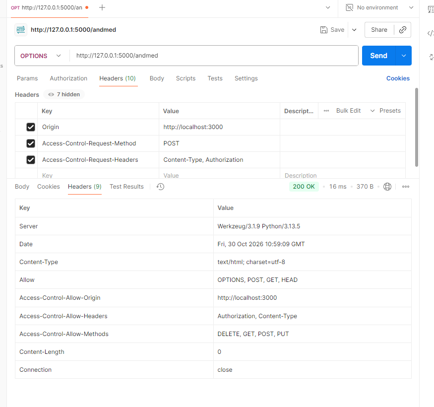
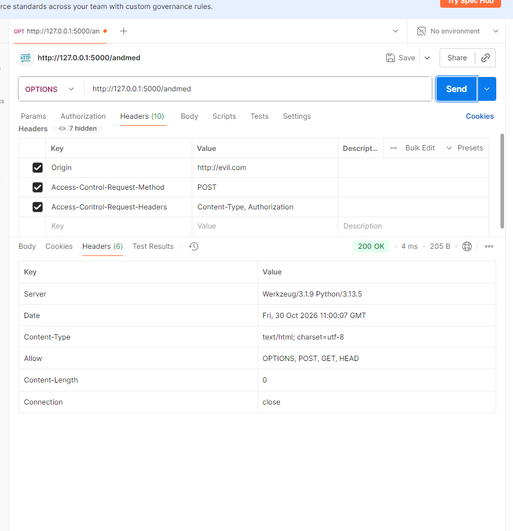
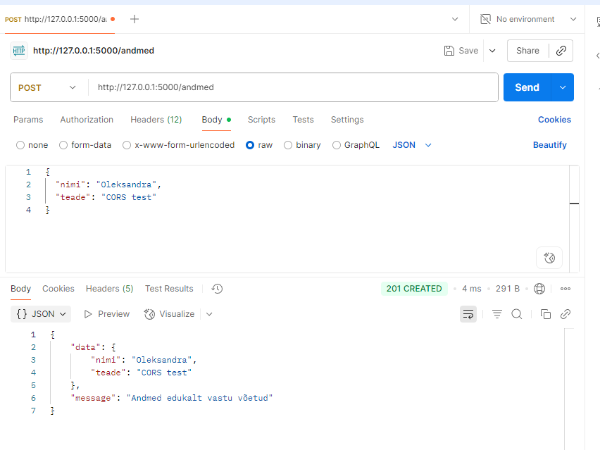
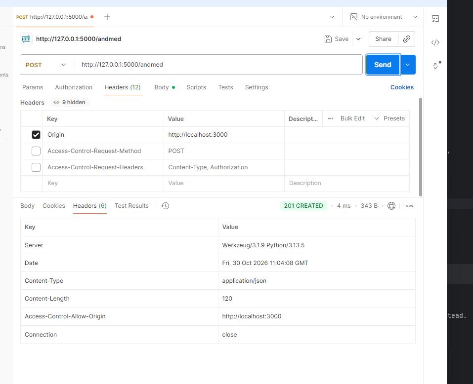
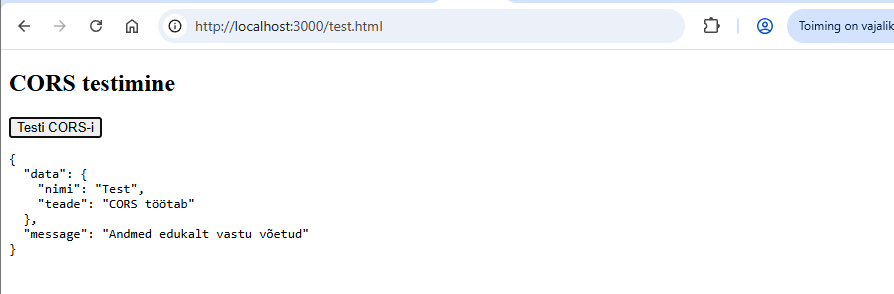
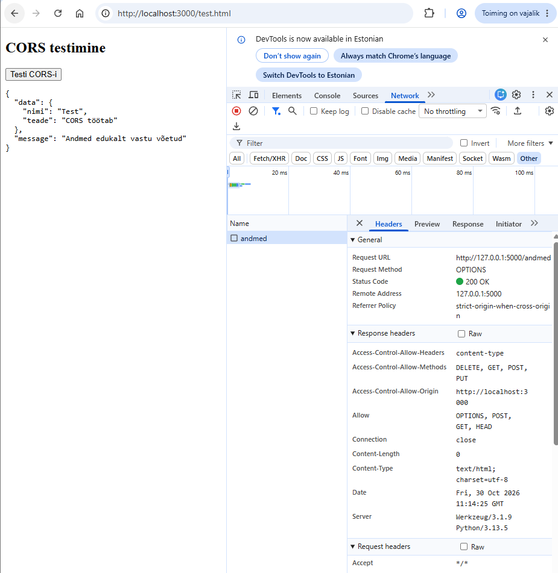
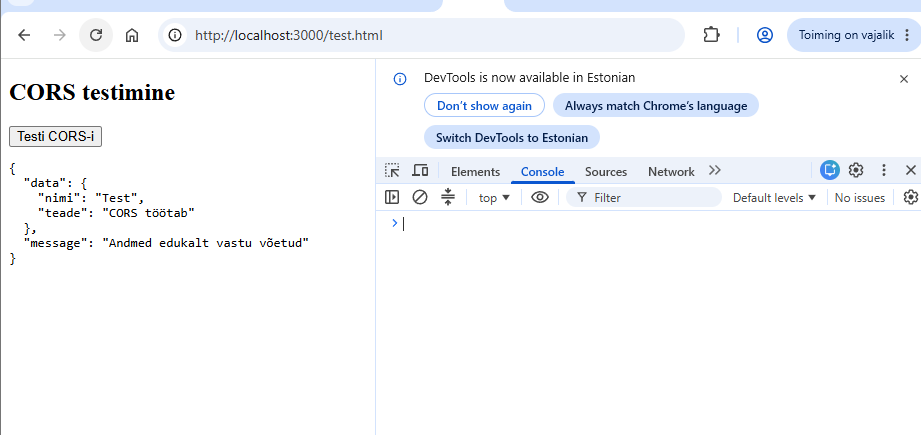

# CORS-i seadistamine ja testimine

## Projekti kirjeldus

Projekti eesmärk on seadistada ja testida CORS-i Flaski rakenduses.

Kasutatud tehnoloogiad:
- Python
- Flask ja Flask-CORS
- Postman
- HTML ja JavaScript
- Chrome DevTools

## 1. GET-päringu testimine

Kontrollisin, et Flaski server tagastab JSON-andmed.

## 2. OPTIONS-päringu testimine

Kontrollisin Postmanis CORS-i preflight-päringut.
Server tagastas staatuse 200 OK ja vajalikud CORS-päised.

## 3. Keelatud päritolu kontroll

Testisin päringut aadressilt http://evil.com.
Server ei lubanud sellele päritolule CORS-i juurdepääsu.

## 4. POST-päringu testimine

Saatsin Postmanis JSON-andmed Flaski serverile.
Server vastas staatusega 201 Created.

## 5. CORS-päiste kontroll

Kontrollisin, et POST-vastuses oleks olemas
Access-Control-Allow-Origin päis.

## 6. Testimine brauseris

Lõin test.html lehe, mis saadab POST-päringu Flaski API-le.
Brauser kuvas serverilt saadud JSON-vastuse.

## 7. DevTools kontroll

Kontrollisin Network-vahekaardil OPTIONS-päringut ja
selle vastusepäiseid. Console'is ei esinenud CORS-i vigu.

## Kokkuvõte

Seadistasin Flaski rakenduses CORS-i ning testisin
GET-, POST- ja OPTIONS-päringuid.

Kontrollisin lubatud ja keelatud päritolusid ning
serveri vastusepäiseid Postmanis ja brauseris.

Kõik testid õnnestusid ja CORS töötab õigesti.